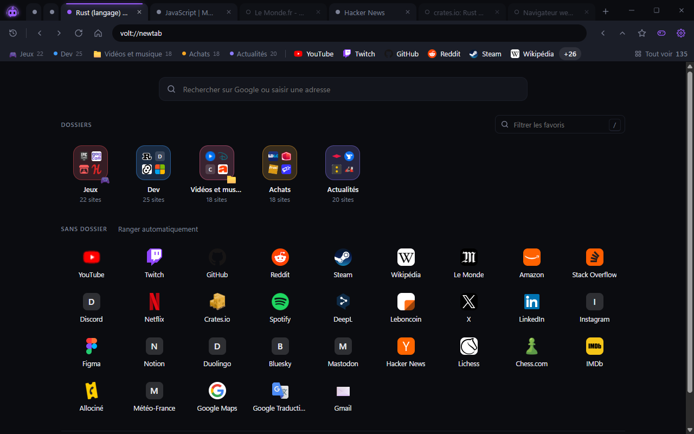
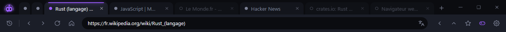
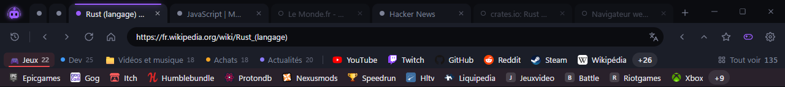
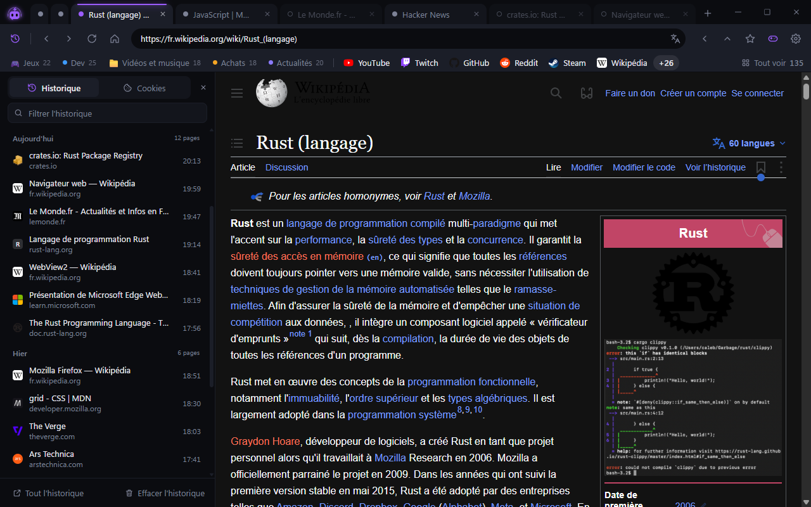
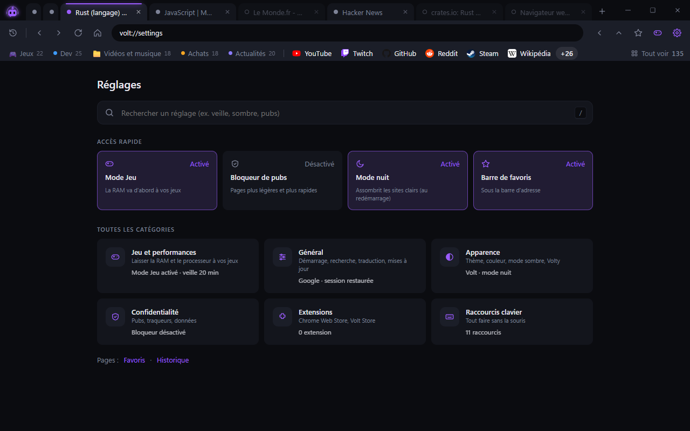

<p align="center">
  
</p>

<h1 align="center">Volt — un navigateur web léger et économe en mémoire pour Windows, écrit en Rust</h1>

<p align="center">
  <strong>La compatibilité de Chromium grâce à Microsoft WebView2. Avec 50 onglets ouverts, il utilise un peu plus du quart de la mémoire de Chrome, parce qu'il n'en garde que 7 chargés.</strong>
</p>

<p align="center">
  <a href="README.md">English</a> ·
  <a href="docs/BENCHMARKS.md">Mesures</a> ·
  <a href="#limites">Limites</a> ·
  <a href="#compiler">Compiler</a>
</p>

<p align="center">
  
</p>

Volt est un navigateur léger, une alternative à Chrome pour qui veut un navigateur qui consomme peu de RAM sans renoncer à la compatibilité avec les sites. C'est une petite application Rust (bâtie sur les bibliothèques `tao` et `wry`) autour du moteur Chromium que Microsoft fournit avec Windows, WebView2. Ce n'est pas un nouveau moteur : les pages s'affichent exactement comme dans Chromium. Le gain vient de la façon dont Volt gère les onglets, pas du moteur.

- Un seul exécutable d'environ 1 Mo, sans installation.
- A besoin de WebView2, déjà présent dans Windows 11.
- Version 0.1.0, développée par une personne. Interface en français uniquement pour l'instant.

## Mémoire comparée à Chrome, Edge et Opera GX

50 onglets identiques sur une quinzaine de sites, profils neufs, réglages par défaut, aucune extension, relevé 3 minutes après le lancement sur tout l'arbre de processus du navigateur. Un seul PC : AMD Ryzen 9 7900X, 64 Go de RAM, Windows 11, 22 novembre 2026.

| Navigateur                                                         | Onglets chargés | Commit            | RAM occupée       |
| ------------------------------------------------------------------ | --------------: | ----------------: | ----------------: |
| Volt 0.1.0 (WebView2 157), défaut, bloqueur coupé                  | 7 sur 50        | 1 104 à 1 147 Mo  | 842 à 885 Mo      |
| Volt, défaut complet (bloqueur de pubs actif)                      | 7 sur 50        | 1 253 Mo          | 965 Mo            |
| Google Chrome 149                                                  | 50              | 4 610 à 4 638 Mo  | 3 606 à 3 686 Mo  |
| Microsoft Edge 158 (compte connecté, synchro active, voir limites) | 50              | 5 066 Mo          | 3 971 Mo          |
| Opera GX (Chromium 155)                                            | 50              | 5 402 Mo          | 4 426 Mo          |
| Volt, les 50 onglets gardés chargés                                | 50              | 5 027 à 5 058 Mo  | 1 359 à 1 435 Mo  |

À lire avec attention :

- L'écart vient uniquement de la gestion des onglets. Chrome, Edge et Opera GX gardent les 50 onglets chargés ; Volt en garde 7 et décharge les autres. Cliquer sur un onglet déchargé le recharge, ce qui prend 0,36 à 0,82 s pour une page moyenne à lourde. Ce coût n'apparaît pas dans le tableau.
- Avec les 50 onglets gardés chargés, Volt réserve environ 9 % de mémoire de plus que Chrome et occupe environ 950 Mo de mémoire vidéo, 5 à 10 fois plus que les autres navigateurs (130 Mo avec 7 onglets chargés).
- Le bloqueur de pubs intégré ajoute environ 130 Mo dans ce scénario.
- Deux essais identiques ont différé de moins de 4 % sur le commit.
- Un seul scénario, une seule machine. Dans ce test, les 7 onglets gardés chargés par Volt étaient tous sur YouTube ; un autre mélange de sites donnerait un autre chiffre.

Méthode complète, versions et toutes les limites du test (en anglais) : [docs/BENCHMARKS.md](docs/BENCHMARKS.md).

Autres mesures sur la même machine :

| Scénario                                          | Résultat                                            |
| ------------------------------------------------- | --------------------------------------------------- |
| 100 onglets ouverts, dont 7 chargés               | environ 1,0 Go de commit                            |
| Idem, RAM occupée                                 | 628 Mo fenêtre ouverte, 32 Mo fenêtre réduite       |
| Processeur au repos                               | 0,9 % d'un cœur (0,03 % avec les onglets cachés gelés) |
| Passage à un onglet chargé ou gelé                | 7 à 21 ms                                           |
| Passage à un onglet déchargé                      | 0,36 à 0,82 s (page moyenne à lourde)               |
| Ouverture de la page de favoris avec 136 favoris  | 5 à 18 ms                                           |

## Comment fonctionne la mise en veille des onglets

- **Budget d'onglets chargés.** Par défaut, Volt garde 7 onglets chargés (réglable de 3 à 25, ou illimité). Les autres sont déchargés et se rechargent au clic. L'onglet actif, ceux qui jouent du son, ceux où du texte est en cours de saisie et les onglets épinglés ne sont jamais déchargés.
- **Gel.** Un onglet caché est gelé après 2 minutes ; le moteur sort alors sa mémoire de la RAM.
- **Retour sur un onglet déchargé.** Une capture de la page s'affiche d'abord, puis la page rechargée, avec le défilement et la position de la vidéo restaurés.
- **La contrepartie.** Ce qui n'existait que dans la page est perdu au déchargement : une saisie non envoyée ailleurs que dans un champ de texte, l'état d'une application web. Épinglez l'onglet, ou augmentez ou supprimez le budget, pour le garder chargé.
- **Rien ne tourne au repos.** Les animations permanentes de l'interface sont coupées par défaut.

<p align="center">
  
</p>

## Fonctions

**Onglets et sessions**
- Onglets épinglés.
- Menu du clic droit sur un onglet : nouvel onglet à droite, dupliquer, épingler, couper le son, fermer les autres onglets, fermer les onglets à droite, rouvrir l'onglet fermé (Ctrl+Maj+T).
- Reprise de la dernière session proposée au démarrage.

**Favoris et historique**
- Barre de favoris en trois styles, et page de favoris en tuiles.
- Import des favoris de Chrome, Edge, Brave, Vivaldi, Opera et Opera GX.
- Rangement automatique des favoris par catégorie, calculé sur votre machine ; rien n'est envoyé.
- Panneau latéral d'historique classé par jour, avec suppression des cookies par site.

**Extensions Chrome et blocage**
- Installation d'extensions du Chrome Web Store par leur adresse, ou d'un clic sur leur fiche. uBlock Origin Lite et SponsorBlock sont recommandées.
- Bloqueur de pubs intégré (uBlock Origin Lite).

**Bandeaux de cookies et traduction**
- Réponse automatique aux bandeaux de cookies, désactivée par défaut : tout refuser ou tout accepter, avec une liste de sites exclus que vous remplissez vous-même. Mesuré sur 25 sites : en mode refuser, tous les sites qui proposent un refus gratuit ont été réglés et aucun consentement n'a été enregistré à tort. Les sites qui n'offrent que « accepter ou s'abonner » gardent leur bandeau en mode refuser.
- Bouton de traduction de la page dans la barre d'adresse, par Google Traduction, avec « voir l'original » sur une page traduite. La traduction automatique des pages en langue étrangère est une option, désactivée par défaut.

**Le reste**
- Recherche de mise à jour depuis les réglages : le nouvel exécutable est téléchargé depuis les versions publiées de ce dépôt, vérifié contre son empreinte SHA-256 publiée, puis Volt redémarre en reprenant votre session.
- Mémorisation et remplissage automatique des identifiants par le moteur, avec un bouton pour supprimer les mots de passe enregistrés.
- Mode Jeu, pour un navigateur qui se fait discret pendant que vous jouez : priorité basse et gel rapide des onglets.
- Six thèmes.
- Peut être défini comme navigateur par défaut.

<p align="center">
  
</p>

<p align="center">
  
  
</p>

## Limites

- Windows 10 et 11 uniquement.
- Interface en français uniquement.
- Utilise le moteur Chromium de Microsoft (WebView2) ; ce n'est pas un moteur maison.
- Un onglet déchargé se recharge et perd l'état propre à la page.
- Les petites fenêtres des extensions ne peuvent pas s'afficher (le moteur ne le permet pas) ; seule leur page d'options s'ouvre.
- Pas de liste consultable des mots de passe enregistrés.
- Exécutable non signé : Windows SmartScreen ou Defender peuvent afficher un avertissement.
- Mémoire vidéo élevée quand on garde beaucoup d'onglets chargés.
- La traduction de page passe par le relais de Google : l'adresse et le contenu de la page lui sont envoyés, vous n'êtes pas connecté sur la page traduite, les formulaires y sont bloqués, et les applications web lourdes peuvent ne pas s'afficher.
- Les mises à jour reposent sur GitHub en HTTPS et sur une empreinte publiée ; il n'y a pas de signature de code.
- Projet jeune, sans audit de sécurité.

## Essayer

Téléchargez `volt.exe` sur la page [Releases](../../releases), puis lancez-le. Aucune installation n'est nécessaire. Sous Windows 10, installez le runtime Microsoft Edge WebView2 s'il n'est pas déjà présent.

## Compiler

Prérequis : Windows 10 ou 11, la chaîne Rust stable (le projet utilise l'édition 2024, donc Rust 1.85 ou plus récent).

```
cargo build --release
```

L'exécutable est écrit dans `target\release\volt.exe`. Fermez Volt avant de recompiler : Windows ne laisse pas la compilation remplacer un exécutable en cours d'utilisation.

## Licence et statut juridique

Pas de licence libre pour l'instant. Le code est publié pour être lu, compilé et essayé. Tous droits réservés : demandez avant de le réutiliser ou de le redistribuer.

Volt n'est affilié ni à Google ni à Microsoft. Chrome, Chromium, Edge et WebView2 sont des marques de leurs propriétaires respectifs.
