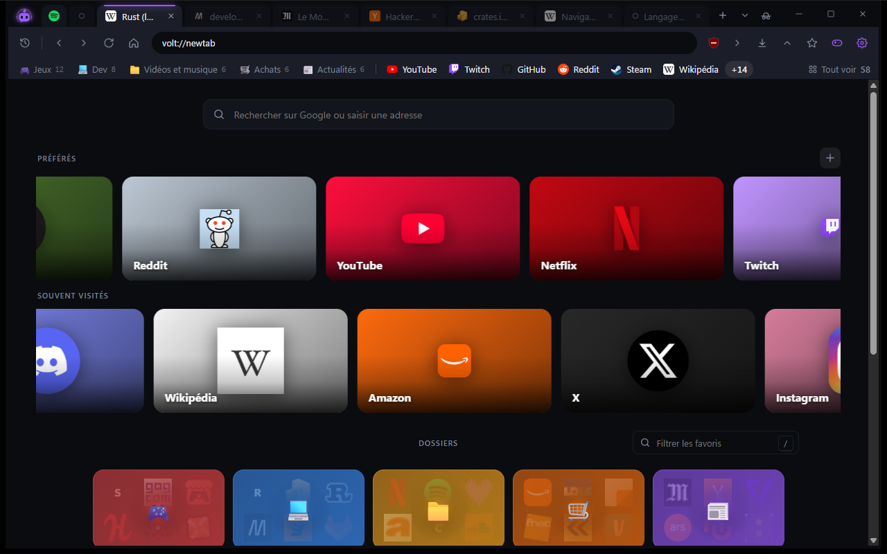
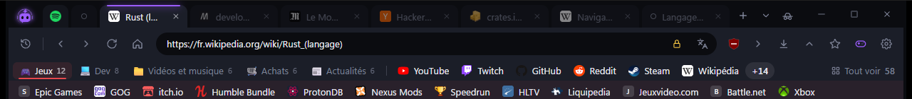
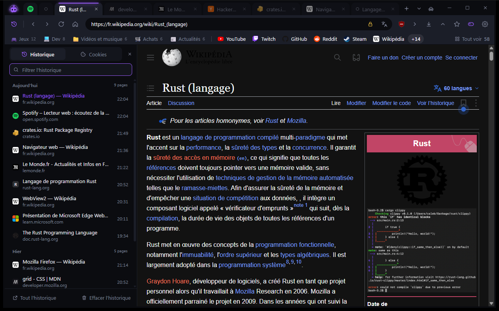
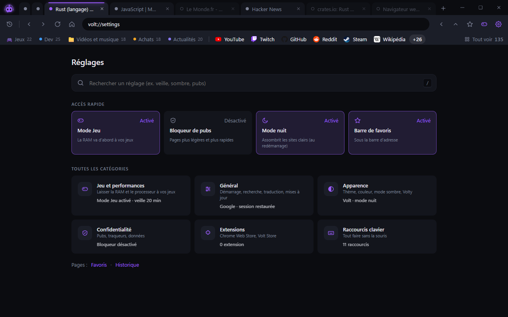

<p align="center">
  
</p>

<h1 align="center">Volt — a lightweight, low-memory web browser for Windows, written in Rust</h1>

<p align="center">
  <strong>Chromium compatibility through Microsoft WebView2. With 50 tabs open, it uses just over a quarter of the memory Chrome uses, because it keeps only 7 of them loaded.</strong>
</p>

<p align="center">
  <a href="README.fr.md">Français</a> ·
  <a href="docs/BENCHMARKS.md">Benchmarks</a> ·
  <a href="#limitations">Limitations</a> ·
  <a href="#build-from-source">Build</a>
</p>

<p align="center">
  
</p>

Volt is a lightweight browser and Chrome alternative for people who want a low RAM browser without giving up site compatibility. It is a small Rust application (built on the `tao` and `wry` libraries) around the Chromium engine that Microsoft ships with Windows, WebView2. It is not a new engine: pages render exactly as they do in Chromium. The savings come from how Volt manages tabs, not from the engine.

- One executable of about 1.5 MB, no installer.
- Needs WebView2, which is already part of Windows 11.
- Version 0.3.0, developed by one person. The interface is in English or French.

## Memory usage compared with Chrome, Edge and Opera GX

50 identical tabs across about fifteen sites, fresh profiles, default settings, no extensions, measured 3 minutes after launch over the browser's whole process tree. One PC: AMD Ryzen 9 7900X, 64 GB RAM, Windows 11, 22 November 2026.

| Browser                                                         | Tabs loaded | Commit           | RAM in use       |
| --------------------------------------------------------------- | ----------: | ---------------: | ---------------: |
| Volt 0.1.0 (WebView2 157), defaults, ad blocker off             | 7 of 50     | 1,104–1,147 MB   | 842–885 MB       |
| Volt, full defaults (ad blocker on)                             | 7 of 50     | 1,253 MB         | 965 MB           |
| Google Chrome 149                                               | 50          | 4,610–4,638 MB   | 3,606–3,686 MB   |
| Microsoft Edge 158 (signed in, sync on — see limitations)       | 50          | 5,066 MB         | 3,971 MB         |
| Opera GX (Chromium 155)                                         | 50          | 5,402 MB         | 4,426 MB         |
| Volt, all 50 tabs kept loaded                                   | 50          | 5,027–5,058 MB   | 1,359–1,435 MB   |

Read this table carefully:

- The difference comes only from tab management. Chrome, Edge and Opera GX keep all 50 tabs loaded; Volt keeps 7 and unloads the rest. Clicking an unloaded tab reloads it, which takes 0.36 to 0.82 s on a medium to heavy page. That cost is not in the table.
- With all 50 tabs kept loaded, Volt commits about 9 % more memory than Chrome and uses about 950 MB of video memory, 5 to 10 times more than the other browsers (130 MB with 7 tabs loaded).
- The built-in ad blocker adds about 130 MB in this scenario.
- Two identical runs differed by less than 4 % on commit.
- One scenario, one machine. In this test the 7 tabs Volt kept loaded were all YouTube; another mix of sites would give a different number.

Full method, versions and every limitation of the test: [docs/BENCHMARKS.md](docs/BENCHMARKS.md).

Other measurements on the same machine:

| Scenario                                          | Result                                         |
| ------------------------------------------------- | ---------------------------------------------- |
| 100 tabs open, 7 loaded                           | about 1.0 GB commit                            |
| Same, RAM in use                                  | 628 MB window open, 32 MB window minimized     |
| CPU at idle                                       | 0.9 % of one core (0.03 % with hidden tabs frozen) |
| Switching to a loaded or frozen tab               | 7 to 21 ms                                     |
| Switching to an unloaded tab                      | 0.36 to 0.82 s (medium to heavy page)          |
| Opening the bookmarks page with 136 bookmarks     | 5 to 18 ms                                     |

## How tab suspension works

- **Loaded-tab budget.** By default Volt keeps 7 tabs loaded (adjustable from 3 to 25, or unlimited). Other tabs are unloaded and reload when you click them. The active tab, tabs playing audio, tabs where you are typing text and pinned tabs are never unloaded.
- **Freezing.** A hidden tab is frozen after 2 minutes; the engine then moves its memory out of RAM.
- **Coming back to an unloaded tab.** A screenshot of the page appears first, then the reloaded page, with scroll position and video position restored.
- **The trade-off.** Anything that existed only inside the page is lost when it unloads: unsent input outside a text field, the state of a web app. Pin a tab, or raise or remove the budget, to keep it loaded.
- **Nothing runs at idle.** The interface's permanent animations are off by default.

<p align="center">
  
</p>

## Features

**Tabs, windows and sessions**
- Several windows: drag a tab out of its window to open a new one, or into another Volt window, without reloading it.
- Private browsing (Ctrl+Shift+N): no history, cookies or session kept.
- Named, colored tab groups that collapse with one click and come back with the session.
- Pinned tabs. When the bar fills up, tabs shrink down to the site icon alone.
- Search open tabs (Ctrl+Shift+A).
- Tab right-click menu: new tab to the right, add to a group, duplicate, move to a new window, pin, mute, close other tabs, close tabs to the right, reopen closed tab (Ctrl+Shift+T).
- Offers to restore the last session at startup.
- Task manager (Shift+Esc): memory and processor use of each tab, with a button to unload the heaviest ones.

**Browsing**
- Address bar suggestions from your bookmarks and history; they are looked up on your machine, nothing is sent to a search engine while you type.
- Find in page (Ctrl+F), per-page zoom, printing, full screen (F11), Ctrl+1 to 9 to jump to a tab.
- Opens PDFs and files from your PC. Fill and sign a PDF: text, drawing, and a signature drawn with the mouse, typed, or placed from a transparent image.
- Downloads page with progress, pause, resume and cancel; a download folder of your choice, or a Save As window for each file.
- Pop-ups are blocked when a site opens one without a click, with a list of allowed sites.
- List of the permissions given to sites (camera, microphone, location, notifications), to take one back.
- Dangerous-site warnings from Microsoft Defender SmartScreen, which you can turn off: the addresses you visit are sent to it for checking.

**Passwords, cards and forms**
- Volt's own password manager: offers to save at sign-in, fills in with one click, a list you can browse, CSV import and export. Viewing, editing, deleting or exporting asks for Windows Hello.
- Payment cards: saved encrypted on your PC, without the security code. On a payment page the card is filled in only when you ask, after Windows Hello, and only in the form you clicked in; Volt first shows you the site that will receive it.
- Form filling (name, address, email, phone) by the engine, which you can turn off.

**Bookmarks and history**
- Bookmarks bar in three styles, folders that open in the bar or as a menu, and a bookmarks page laid out as tiles.
- Import bookmarks from Chrome, Edge, Brave, Vivaldi, Opera and Opera GX, and import or export in the HTML format every browser shares (Firefox included).
- Automatic sorting of bookmarks into categories (games included), computed on your machine; nothing is sent anywhere.
- Side panel with history grouped by day, and per-site cookie deletion.

**Chrome extensions and blocking**
- Install Chrome extensions from the Chrome Web Store by their address, or with one click on their store page. uBlock Origin Lite and SponsorBlock are recommended.
- Built-in ad blocker (uBlock Origin Lite).

**Cookie banners and translation**
- Automatic answers to cookie banners, off by default: refuse all or accept all, with a list of excluded sites you fill in yourself. Measured on 25 sites: in refuse mode every site that offers a free refusal was handled and no consent was recorded by mistake. Sites that only offer "accept or subscribe" keep their banner in refuse mode.
- Translate-page button in the address bar, through Google Translate, with a "show original" button on a translated page. Automatic translation of foreign-language pages is an option, off by default.

**Everything else**
- Update check from the settings: the new executable is downloaded from this repository's releases, checked against its published SHA-256, and Volt restarts with your session restored.
- Game Mode, for a gaming browser that stays out of the way: low priority and fast tab freezing while you play.
- Six themes.
- Interface in English or French: it follows the Windows display language, or the language you pick in the settings; page translation and the engine (page menus, error pages, the language requested from websites) then use that language too.
- Can be set as the default browser; desktop and Start menu shortcuts, and uninstall from the Windows installed apps list.
- Hover the mascot to see the memory, processor and graphics card Volt is using.

<p align="center">
  
</p>

<p align="center">
  
  
</p>

## Limitations

- Windows 10 and 11 only.
- Interface in English and French only for now.
- Uses Microsoft's Chromium engine (WebView2); it is not its own engine.
- An unloaded tab reloads and loses state that existed only in the page.
- Extension popups cannot be shown (the engine does not allow it); only an extension's options page opens.
- No sync between devices.
- Passwords and cards live in Volt's own vault, encrypted by Windows and tied to your session: a program running under your account can read it, as with Chrome. This vault has not been audited.
- The card is filled in only in the form you clicked in: a field held by a different site (sometimes the cardholder name) is left for you to type.
- A signature placed on a PDF is an image, not a certified electronic signature.
- The downloads list starts empty at each launch.
- The executable is not signed: Windows SmartScreen or Defender may show a warning.
- High video memory use when you keep many tabs loaded.
- Page translation goes through Google's relay: the page address and content are sent to Google, you are not signed in on the translated page, forms are blocked there, and heavy web apps may not display.
- Updates rely on GitHub over HTTPS and a published checksum; there is no code signature.
- Young project, no security audit.

## Try it

Download `volt.exe` from the [Releases](../../releases) page and run it. No installation is needed. On Windows 10, install the Microsoft Edge WebView2 Runtime if it is not already present.

## Build from source

Requirements: Windows 10 or 11, the stable Rust toolchain (the crate uses edition 2024, so Rust 1.85 or later).

```
cargo build --release
```

The executable is written to `target\release\volt.exe`. Close Volt before rebuilding: Windows will not let the build replace a running executable.

## License and legal status

There is no open-source license for now. The code is published so you can read it, build it and try it. All rights reserved: ask before reusing or redistributing it.

Volt is not affiliated with Google or Microsoft. Chrome, Chromium, Edge and WebView2 are trademarks of their respective owners.
